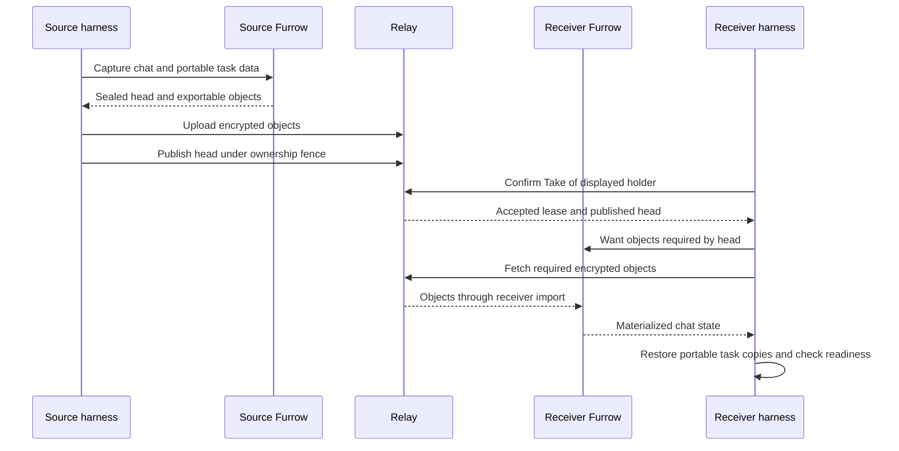
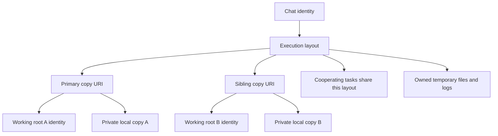
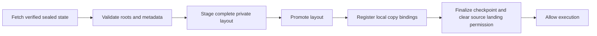

# Workspace storage and relay architecture

This page separates the shipped relay from the proposed workspace lifecycle.
The source baseline is `dev` at `7f5da935c`. The multi-root extension has been
exercised in a separate prototype; this documentation does not ship it or enable
automatic compaction. The resident-graph design in [ARCHITECTURE](../ARCHITECTURE.md)
is a separate design and is not the current chat storage schema.

## Shipped relay: ownership and encrypted content

The chat harness owns execution and the selected local folders. Furrow captures
and materializes sealed chat state; `cellsync` transports encrypted objects;
the relay stores those objects and the directory's published heads and leases.
A lease elects a chat's holder. It is not permission to write an arbitrary local
folder. Pairing and the encrypted vault have their existing separate policies.

Publishing uploads objects before advancing the directory head. A stale fence
cannot overwrite the new holder. Fetching may prime from advertised frames, but
Furrow's `Want`/import loop establishes completeness before materialization;
frame listings are hints, not completeness proofs.

Task worktrees live outside the ordinary sealed chat tree. `taskcopy.Carry`
composes portable commits and uncommitted changes under `.cell/trees` and restores
them at receiver-local paths. Files omitted by the portable representation do
not become transferable merely because a task used them. A successful chat Take
is not a guarantee that every external command or dependency can resume.

Source seams: [publisher](../../internal/cellsync/publish.go),
[fetcher](../../internal/cellsync/fetch.go),
[native sync adapter](../../internal/cellstore/syncops.go),
[Take](../../internal/syncsetup/take.go),
[portable task copies](../../internal/taskcopy/doc.go), and
[chat file policy](../../internal/chatfiles/chatfiles.go).

## Multi-root extension: identity is not a path or permission

The proposed unit is a **working root**, a dynamically selected folder. It need
not be a Git repository, and it is not everything a conversation works on.
One chat can reference several roots. Each execution declares a primary root
and its explicit sibling uses. Every copy URI identifies exactly one physical
copy; a layout groups several copies without combining their identities.

| Resource | Contract |
| --- | --- |
| Working root | Stable opaque identity; receiver admits each association separately |
| Chat | References many roots; has its own history and execution frontier |
| Execution layout | Primary root plus declared read/write sibling uses |
| Copy | One physical copy, owned by a chat/execution and bound locally |
| Landing destination | Separate explicit permission; never inferred from a source URI |

The harness prepares private copies for delegated work by default. Cooperating
tasks can share an identical admitted layout; independent work gets separate
copies. Foreground edits retain the explicitly opened project's existing
semantics. A model's brief, an absolute source path, matching names, and matching
Git remotes cannot grant landing authority or merge two root identities.

The registry maps identity to local placement. It remains device-local; relay
carries portable references and bytes, not another device's path authority.
Reopen resolves the recorded identity and validates ownership. An unknown or
incomplete binding refuses rather than silently using a historical path.

## Receive and restart contract

The extension must validate the entire required root closure before admission.
Each root is associated independently with an accepted receiver destination.
Reconstruction uses private staging and full history when the receiver lacks a
verified Git base. It does not unbundle into a borrowed original repository.

A durable operation receipt spans promotion, registry admission and checkpoint
finalization. This is recovery across several stores, not one atomic database
transaction. Retries recognize the recorded operation and expected checkpoint;
they must not duplicate copies or resume against a partly restored layout.

Git does not represent empty directories or directory permissions. A portable
root therefore needs an explicit versioned directory map in addition to file
content, executable modes, deletions and line-ending metadata. Missing or
unsupported metadata must refuse without discarding the original carrier.
This is not a promise about every filesystem's ACLs, ownership or special files.

A fork retains completed results and portable history while detaching inherited
active execution authority. Unchanged inputs should not be duplicated as result
artifacts. A later Take must retain that history without reviving old workers.

## Storage lifecycle and safety

The proposed lifecycle is `resident → retiring → cold → restoring → resident`.
An owned archive is captured, verified and recorded durably before an eligible
resident copy is removed. Restore verifies exact supported state before use.
Shared content chunks may serve many manifests without merging ownership.

Original projects, unrelated caches and uncertain writers are protected.
Shell guards and temporary-directory settings are not an operating-system
sandbox: detached writers and remote commands require separate ownership and
quiescence evidence. Uncertain copies stay resident. Multi-root copies currently
stay resident in the prototype; this design does not establish automatic
normal-use reclamation or a long-term storage budget.

## Compatibility and migration

This documentation-only change performs **no migration**. A future implementation
needs an explicit rollout before these contracts can become defaults:

| Boundary | Required behavior |
| --- | --- |
| Legacy singleton checkpoint | Preserve its existing reader and restore behavior; no forced rewrite |
| New multi-root checkpoint/carrier | Version schema, record all required roots, directory metadata and digest binding |
| Early prototype with missing directory metadata | Refuse safely; recapture from intact source if available |
| Missing recorded Git baseline | Preserve full history; refuse changed-output extraction instead of guessing HEAD |
| Mixed or incomplete execution history | Refuse unsupported combinations without dropping records |
| Receiver capabilities | Establish format support before mutation; older clients currently lack a guaranteed early refusal |
| Local path bindings | Re-admit per device; never import remote absolute paths as authority |

Both ends need supported readers during prototype testing. A capability handshake
and restart/recovery tests are prerequisites to a general rollout. The original
copy must survive a failed upgrade or restore; restoring an old binary is not a
safe rollback if it cannot understand the new records. Do not compact away the
last readable copy while compatibility is uncertain.

Fast routine key rewrapping, if introduced, must remain separate from full
compromise recovery. Rewrapping an unchanged content key cannot revoke content
already exposed by a compromised key; it cannot silently replace full rotation.

## Measurements and remaining acceptance

Separate experiments measured **43.34% lower allocated use** on isolated copies
of a real-worktree corpus and **55.17% lower warm materialization latency** in a
matched relay experiment. The latter reduced HTTP body bytes by **5.33%**;
latency reduction is not byte reduction. These are prototype measurements,
not promised defaults, host-wide free-space reclamation, or four-month usage
results. The new multi-root flow has no matched old/new savings percentage.

An actual-model prototype sequence preserved supported bytes and metadata across
engine restart, local Take, fork and a second Take. The completed task card still
reported `incomplete`; a cross-machine receiver check was blocked by an offline
receiver. Active cross-device plan recovery, the complete filesystem metadata
matrix, and automatic multi-root compaction remain unverified. Green checks on
this documentation PR do not close those implementation gates.
