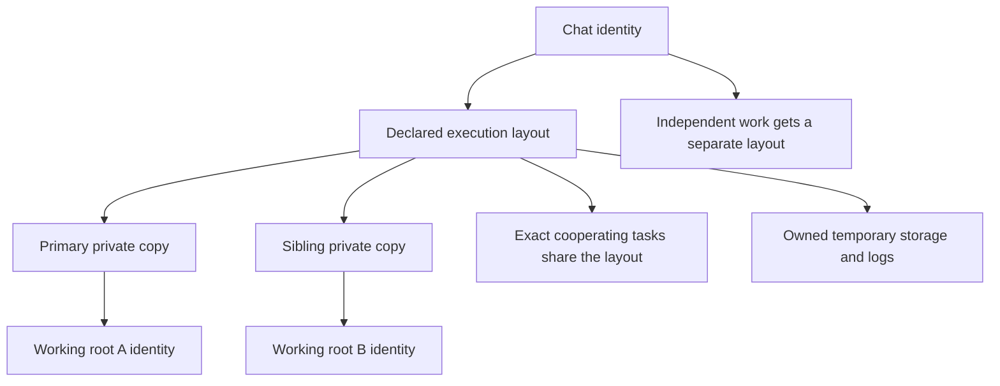
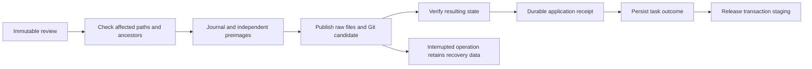
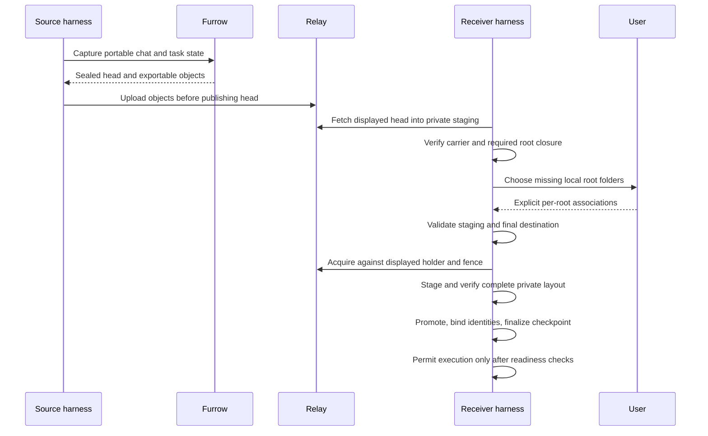

# Workspace storage and relay architecture

This implementation separates working-root identity, private task placement,
explicit result application, and encrypted transfer. A working root is a
selected folder, not necessarily a repository or everything a chat works on.
One chat may use several roots. The [architecture map](../ARCHITECTURE.md) distinguishes this chat storage
from the separate resident surface.

## Folders, ownership, and cooperation

The harness chooses delegated task placement. A model names inputs and relative
layout; its brief cannot grant permission to write an original project. An
execution has one primary root and explicit read/write sibling roots. Root names
are distinct portable directory names; overlapping or unsupported sources are
refused rather than silently renamed.

```text
profile/
  workspace-identities/       local opaque-URI bindings and ownership
  workspace-runtime/<id>/     owned temporary storage
  workspace-caches/<id>/      explicitly shared project cache
  workspace-apply/<id>/       local reviewed snapshots and operation receipts
chat/
  .cell/                     portable chat truth and task carriers
  trees/<run-id>/
    app/                     private primary copy
    library/                 private sibling copy
  logs/                      chat-owned logs
```

Paths above describe roles, not portable absolute locations. The local registry
maps identities to the actual device paths. Project caches are project-owned,
so finishing one task does not authorize deleting a cache shared with another.
Original folders and unrelated caches never become task cleanup targets.

Plain-folder family history preserves the bounded nonsecret inputs needed to
reconstruct a child's complete working world, including ignored runtime inputs.
Ignore rules do not silently remove those family inputs to claim space savings.
Git-backed sources retain their existing copy eligibility. Credentials withheld
by the existing secret policy remain local inputs; their values do not enter new
transferable family history. Their explicit disposition is bound to the creation
metadata. New or changed withheld outputs refuse review, and existing history
containing tracked secrets refuses full export instead of being rewritten.



Cooperation reuses an already admitted layout; it does not broaden a read-only
root or silently add a sibling. Independent conversations retain independent
execution. Foreground commands keep the semantics of the project the person
explicitly opened. Home/reference tasks keep scratch space rather than copying
an entire home directory. Shell placement and environment variables are not an
operating-system sandbox for detached writers or remote commands.

Source seams: [placement](../../internal/session/workspace_ownership.go),
[layout preparation](../../internal/session/workspace_set_prepare.go),
[identity registry](../../internal/workspaceidentity), and
[conversation storage](../../internal/session/workspace_chat.go).

## Identity does not grant write permission

| Resource | Contract |
| --- | --- |
| Working root | Opaque identity for one selected folder; each receiver association is explicit |
| Chat | Own history and execution frontier; references several roots |
| Execution layout | Primary copy plus explicit read/write sibling uses |
| Copy | One physical copy with local ownership and placement |
| Landing destination | Separate user permission; never inferred from a source identity |

Equal folder names and Git remotes do not merge identities. URI records are
local authority and are not copied between devices as a path database. Result
application must be explicit for each writable root, with conflicts retained;
receiving a root does not authorize applying changes to it.

## Review and apply one root

Use `/task review <task number> <root slot>` after the task and its cooperating
writers/checkers finish. The terminal shows the private copy, receiver-local
application destination, exact snapshot identity, and diff. Large previews show
a command for inspecting the complete immutable Git/file diff; that command
does not describe all directory or permission metadata. Review does not change
the original project working files or the retained private working copy.

`/task apply <task number> <root slot>` applies that reviewed snapshot only.
Changes arriving in the private copy after review are retained there and do not
enter this application. Every writable root has a separate operation; read-only
roots cannot be applied. Conflicts preserve both versions. Successful application
records its outcome and prevents a duplicate apply. The original private copy
and its URI remain available after restart.

Explicit reviewed Apply can update the chosen branch, including `main`.
Automatic task landing retains its protected-branch refusal. Both paths retain
checkout-movement checks; reviewed Apply also retains its ref/index transaction
and affected-path conflict checks.

Reviewed staging and its receipt are local profile assets, separate from the
portable conversation. A replacement review retires only its verified previous
staging after the new receipt is durable. Invalid ownership, destination,
baseline, or snapshot bindings refuse before application. Uncertain writers still
prevent destructive retirement; they do not authorize deleting the retained
original during a snapshot application.

Private task creation records eligible raw bytes, file kinds, symlink targets,
permission bits, and empty directories before Git can normalize them. That
immutable baseline travels with the task carrier; it grants no destination
write authority. Existing tasks without a verified metadata baseline retain
their readable results, but application refuses instead of inventing history.

Native control metadata at the workspace root is owned by the local engine,
separate from project inputs. Capture and restore agree on that boundary;
incoming records cannot overwrite it. Nested project folders with the same name
remain ordinary user content. This distinction does not expand cleanup authority.

Application uses a journaled destination transaction. Independently copied
preimages and verified raw postimages remain available until the final task
checkpoint is durable. Built-in Git text conversion produces canonical history
while working files retain their exact reviewed bytes. External clean filters
and unsupported working-tree encodings refuse before publication. Affected
paths with pre-existing staged or unstaged changes refuse; unrelated changes
remain untouched. Ignored or withheld content never becomes an inferred deletion.



The portable contract covers raw bytes, supported file and symlink kinds,
POSIX permissions, and eligible directories. It excludes timestamps. Affected
ownership, hardlink, xattr, native ACL, filesystem-flag, and special-file state
that cannot be represented must refuse before mutation. Split indexes and
unsupported Git reference-storage formats also refuse before mutation until
independent recovery is supported. The original project
root's permissions are preserved. This transaction does not give unrelated
readers atomic visibility across all files and Git metadata, or fence unmanaged
external writers. Outside changes that prevent safe recovery retain the
preimages and produce an actionable error. Cancellation before the durable
application receipt rolls back when safe; after that boundary the task outcome
is finalized. Hardware power-cut validation has not been performed.

The terminal enters these operations through the resident engine, with the
conversation's driver/session binding and cancellable operation deadline. An
older engine without the capability asks for an engine update and reconnect. A
disconnect after application begins can leave an unknown outcome: inspect the
recorded result before retrying.

## Relay: fetch, map roots, acquire, restore

Furrow owns byte capture, cryptographic verification and materialization.
`cellsync` schedules transport. The relay stores encrypted objects and an
authenticated directory of published heads and leases. The harness owns
execution, local folder admission, and result application. A lease elects the
chat holder; it does not authorize writing arbitrary folders.



The receiver's existing folder picker asks for each missing root. Escape cancels
without taking the lease. A retry retains the holder/fence the person saw, so a
changed holder requires a fresh decision. Bindings overlapping private receiver
storage are rejected before takeover. If staged admission fails, the original
native timeline binding is restored so a valid retry remains possible.

Publishing uploads before advancing the directory head; stale fences cannot
overwrite the holder. Bounded existing-frame advertisements may prime fetching,
but Furrow's authoritative `Want`/import loop proves completeness. Hints cannot
substitute for verified objects.

Source seams: [publish](../../internal/cellsync/publish.go),
[fetch](../../internal/cellsync/fetch.go),
[handoff](../../internal/handoff/handoff.go),
[receiver orchestration](../../internal/syncsetup/take.go), and
[task transfer](../../internal/session/workspace_transfer.go).

## Reopen, restart, and fork

Task workspaces are carried separately from ordinary sealed chat files.
Portable commits, uncommitted changes, and explicit versioned directory metadata
preserve supported state. Git alone cannot preserve empty directories and
directory permissions. Missing metadata, invalid digest bindings, or an unknown
recorded baseline refuse rather than guessing a replacement.

Restore uses private staging and full history when no verified Git base is
available. It never unbundles into a borrowed original repository. A durable
receipt spans promotion, registry admission and checkpoint finalization; retries
recognize the same operation rather than creating a second copy. This recovery
protocol spans several stores, not one atomic database transaction.

A fork retains completed results and portable history, with inherited active
execution detached. It does not duplicate ongoing workers or spending. A later
Take must preserve those results without reviving the original frontier.
Successful chat transfer does not guarantee that arbitrary external commands or
dependencies can resume on another device.

## Local archives and storage safety

The local lifecycle is `resident → retiring → cold → restoring → resident`.
An eligible owned copy must be captured, independently verified and recorded
durably before retirement. Restore verifies supported bytes and metadata before
use. Deduplicated compressed chunks may serve several manifests without
combining their ownership.

The archive implementation is a separate native dependency:
[Furrow v0.3.2](https://github.com/Agent-Field/furrow/releases/tag/v0.3.2).
Its local archive database is not a relay wire format. Ordinary builds use the
published release with six platform checksums recorded in the embedded pin;
acceptance does not depend on an unpublished local native artifact. Windows
builds do not expose the Unix archive command.

Uncertain writers stay resident. Multi-root layout retirement remains excluded
until whole-layout quiescence and recovery are verified. Unsupported ACLs,
ownership, filesystem flags, special files, or other unverified metadata must
retain the resident copy. No four-month automatic reclamation claim follows
from the archive experiment.

## Compatibility and migration

| Boundary | Required behavior |
| --- | --- |
| Legacy conversations | Preserve existing placement and readers; no silent historical rewrite |
| New owned conversations | Persist versioned placement policy so restart does not depend on a shell flag |
| Multi-root carriers | Validate every required root, directory map and digest before execution |
| Creation metadata | Preserve verified baseline bytes and digest through relay; missing legacy metadata refuses Apply while retaining readable results |
| Mixed or incomplete history | Refuse unsupported combinations without dropping records |
| Receiver paths | Re-admit per device; remote paths never become write authority |
| Older readers | Require supported readers; guaranteed early capability refusal is still unfinished |

Do not retire the last readable copy while compatibility is uncertain. Installing
an older executable is not a sufficient rollback for records it cannot read.
Fast routine key rewrapping, if introduced separately, cannot replace full
compromise recovery or revoke content exposed by an old key.

SQLite backup capture stages verified database and journal bytes privately before opening them through SQLite. It does not SQLite-open original working roots, avoiding source WAL/shared-memory mutations. Writers must remain quiescent during capture; sequential file capture is not an atomic live-database snapshot.

## Validation and measurement limits

Separate experiments measured **43.34% lower allocated use** inside an isolated
volume containing copies of a real-worktree corpus, and **55.17% lower warm
materialization latency** in a matched transfer test. The transfer experiment
reduced HTTP body bytes by **5.33%**. These are different experiments; latency
reduction is not byte reduction, and isolated-volume reduction is not original
host free-space reclamation. Multi-root normal usage has no matched savings
percentage yet.

Focused tests cover ordinary owned task admission, exact cooperation, directory
metadata, root mapping, cancellation, stale holders, preflight refusal and retry.
The scripted actual-terminal chain passes with the published native dependency:
private tasks, restart, receiver root selection, Take, completed results, public
fork, and a second Take. This verifies the application flow with scripted
responses. Actual-provider and cross-machine acceptance of the final portable
application candidate remains pending; draft status remains appropriate until
that complete chain is verified.
