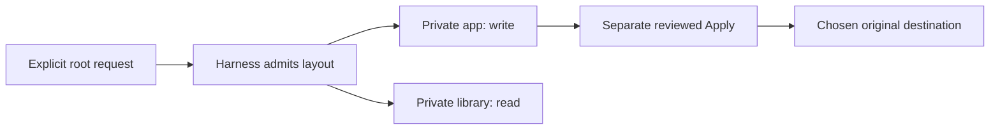
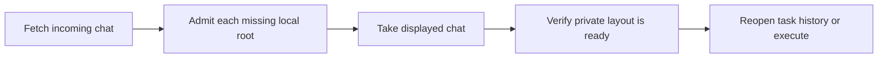

# Task workspaces and relay: agent contract

Read this contract when delegating work across folders, cooperating on a task,
receiving a chat, applying task results, or cleaning task storage. Use the
[shipped worker manual](../../internal/manual/chat/worker-harness.md) for the
complete user-facing command reference. Current acceptance evidence and limits
belong in [PR #1944](https://github.com/Agent-Field/CodeAF/pull/1944).

## Choose the execution roots before delegating

A **working root** is one selected folder. It may be a repository or a plain
folder. A chat can reference several roots; a root is not the whole chat or a
user's entire product. Registry records named `Project` identify local roots.
Matching folder names or Git remotes do not combine their identities.

New managed conversations persist their private-task placement policy. Supported
Bash tasks receive private copies by default; legacy conversations keep their
recorded placement and existing readers. An explicit user-selected in-place mode
keeps its existing meaning. A model's brief or proposed folder does not grant
in-place write permission. Home/reference work uses scratch space rather than
copying the person's home directory. Foreground commands retain the semantics of
the folder the person opened.

For multiple roots, include `workspace_set` in the **`propose_task` tool
arguments**, alongside its required task fields. For example:

```json
{
  "workspace_set": {
    "primary": "app",
    "roots": [
      {"source": "/selected/app", "slot": "app", "access": "write"},
      {"source": "/selected/library", "slot": "library", "access": "read"}
    ]
  }
}
```

Use 1–64 roots. `primary` must name a declared slot. Slots are distinct portable
ASCII directory names, including case-insensitive uniqueness. `access` is
exactly `read` or `write`. Each `source` is an explicitly selected existing
absolute folder without symlink ancestors; an admitted opaque `source_uri` can
resolve that source instead. Omit `ground`, `where` and `via` when declaring this
layout. Landing permission is not a model tool argument.

Before editing, read the worker's admitted root map. Confirm its primary folder,
each sibling slot, and each access mode; write to those private routes. If a root
is missing or the layout is refused, stop that execution and correct the request.
Do not substitute an original folder. Shell placement is not an operating-system
sandbox: unrestricted commands and remote commands need their own explicit scope.



## Cooperate within the admitted layout

Exact cooperating tasks reuse the admitted private layout. Keep the same root
identities, slots and access modes; cooperation cannot add a sibling or broaden
`read` to `write`. Independent work receives an independent layout. A new chat
or fork does not acquire another chat's active execution authority.

Wait for cooperating writers and checkers to finish before reviewing results.
Retain their private copies while completion or writer ownership is uncertain.

## Review and apply each writable root

1. Run `/task review <task number> <root slot>`. Check the displayed private copy,
   Apply destination, snapshot and diff. Large previews provide a command to
   inspect the complete file diff; that diff does not describe every directory
   or permission change.
2. After the user reviews it, run `/task apply <task number> <root slot>` for that
   root. Apply uses the reviewed snapshot. Later edits remain in the private copy.
3. Read the recorded outcome before continuing. Repeat review and Apply separately
   for every writable root; a read-only root cannot be applied.

Explicit reviewed Apply permits the chosen branch, including `main`. Automatic
landing remains blocked on protected branches. Changed checkouts, affected-path
conflicts and unsupported state refuse rather than overwrite work. Unrelated
staged and unstaged changes remain intact. Successful Apply retains the private
copy and records its outcome across restart; it does not grant general source
write permission.

If the connection drops after Apply begins, treat the outcome as **unknown**.
Reconnect and inspect the task's recorded result before retrying. Preserve any
recovery data named by the error. An older engine without the operation requires
an update and reconnect to the updated engine; restarting a window alone may
leave its existing engine running.

## Receive and reopen a chat

Use a managed profile and compatible workspace-aware builds at both ends. Fetch
and Take use the harness's private staging and identity registry. Do not restore
into an arbitrary absolute destination or hand-edit registry/checkpoint files.



Choose an existing receiver-local folder for **each** missing root in the picker.
Confirm the selected folder is the intended root, not its parent or sibling.
The picker waits for directory listings before confirmation. Mappings overlapping
private receiver storage refuse. Escape cancels without taking the lease; a
changed holder requires a fresh Take decision. An association already admitted
to another local folder cannot be silently rebound.

Treat every URI as opaque local authority. A remote path, shared name or Git
remote is not a receiving association and does not authorize Apply. Foreign
owned copies, missing required roots, unsupported versions, incomplete metadata
and invalid bindings must refuse before execution. Fix the missing association
or use a supported build; preserve the last readable copy while compatibility is
uncertain. Guaranteed early refusal by every older reader is not established.

Restart requires the complete recorded layout. Completed worker transcripts and
recorded models reopen from owned local history, rather than another device's
absolute index paths. Receiver-local paths may differ from the incoming paths;
use the admitted local layout rather than comparing or rewriting raw checkpoint
paths. A fork retains settled results and history while inherited active tasks
remain detached, avoiding duplicate execution and spending. Restored files alone
do not establish that an active external command or dependency can resume.

## Preserve supported state and clean only owned fixtures

Supported task capture and Apply preserve raw file bytes, eligible regular files,
literal symlink targets, POSIX permission bits and empty directories. Timestamps
are excluded. Unsupported ownership, hardlinks, extended attributes, native ACLs,
filesystem flags, special files or Git storage/filter configurations refuse when
they cannot be preserved safely. Missing verified legacy creation metadata keeps
results readable but blocks Apply. Secret screening remains in force; withheld
content is not an inferred deletion. SQLite writers must be quiescent during
capture; this is not an atomic live-database snapshot.

Preserve originals and uncertain worktrees. Multi-root layouts remain resident;
this contract does not promise automatic long-term reclamation. Archive support
uses the pinned published [Furrow v0.3.2](https://github.com/Agent-Field/furrow/releases/tag/v0.3.2),
with platform-specific capability limits.

For test cleanup, stop owned workers, daemons and tunnels first. Remove only the
fixture folders, temporary copies and task-specific caches whose ownership was
recorded for that test. Preserve shared project caches, shared build caches,
original projects, unrelated worktrees and retained user results. Task completion
alone does not authorize deleting those assets.
