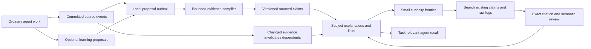

# From memory extraction to a learning knowledge base

A useful knowledge base learns from work, explains subjects, notices consequential
missing knowledge, and repairs itself as evidence changes. It must not turn every
message into a note or every unfamiliar word into an autonomous research task.
All subjects and relationships come from evidence; there is no built-in entity
list or company/project taxonomy.

## Inspiration ledger

| Reference | Adaptation now present | Further integration |
|---|---|---|
| [second-brain: distill](https://github.com/eugeniughelbur/obsidian-second-brain/blob/2c5c7f5f9aad22e0b02efe9856cf0ec8eeda81d7/commands/obsidian-distill.md) | Exact source spans, original-message inspection, source-only gap answers | Incremental source-block indexing |
| [second-brain: emerge/reconcile](https://github.com/eugeniughelbur/obsidian-second-brain/tree/2c5c7f5f9aad22e0b02efe9856cf0ec8eeda81d7/commands) | Evidence-driven subjects, candidate conflicts, bounded curiosity and separate answer review | Reviewed pattern hypotheses without promoting repetition to fact |
| [obsidian-mind](https://github.com/breferrari/obsidian-mind/blob/fae7be467fc5e23bf9d51df7207d41f0c07e2754/AGENTS.md) | Stable IDs for unambiguous renames, meaningful topic connections, stale-answer withholding and original-source citations | Human overrides, transactional repair and compact live agent briefings |
| [claude-skills](https://github.com/robabby/claude-skills/tree/adad740e3c43e0dbf4d54454d191297ef8982b48/skills) | Separate ordinary work/proposals, reflection, curiosity, recall and maintenance | Production lifecycle adapters; measure capture omissions |
| algo-crosspollinator catalog | Budgeted/diverse selection, per-question evidence fingerprints and local dependency checks | Measure local discovery repair, reversible aliases and topic hysteresis before adopting heavier algorithms |

The pollinator was reapplied using topology, bounded selection, identity,
incremental repair and selective acquisition searches. Its mathematical analogies
are hypotheses, not proofs. We rejected suggestions to treat source-ID counts as
independent corroboration, to turn semantic scope labels into ACLs, or to use a
PQ-tree as an identity solution. No extra model or embedding service is introduced.

## Architecture

The working agent can optionally propose knowledge during its ordinary completion.
The collector binds `self` citations to the committed normal response, assigns
trusted host owner/project keys, checks quotes, deduplicates exact proposals and
stages them. It never accepts memory based on a matching quote alone. Empty or
malformed optional learning must not break normal work. The experimental contract
is in [WORKING-AGENT-PROMPT.md](WORKING-AGENT-PROMPT.md).

This is cheaper in principle because the agent already has relevant context.
The instruction and output tokens still cost money. Production integration must
measure response quality, omitted knowledge, streaming behavior and actual total
charges. A proposal tool is useful only if it does not force another model turn.

## Bounded curiosity and gap closure

`maintenance.maintain` accepts the original permitted vault, learned subjects,
a provider, previous maintenance state, a question budget and optional task
context. It shortlists at most 64 questions with subject coverage, chooses at
most eight by default with at most two per subject, and leaves the rest in a
backlog. The first useful pass needs at most three ordinary completions:
prioritize, investigate and independently review. There is no recursive researcher.

A local FTS index searches active claims and original message text. Each selected
question receives up to four claim candidates and three exact source snippets;
combined investigation context is capped at 32,000 characters. No model rereads
all history. Different spans of one message retain distinct snippet identities.
The in-memory FTS index is currently rebuilt each invocation; a production adapter
should incrementally update the existing SQLite index rather than rebuild it.

Questions can be answered, partially answered, blocked by inspected evidence,
budget-deferred or backlogged. An unanswered search is not a negative fact.
The answer reviewer receives the original question text as well as source
material: a valid statement is not necessarily a complete answer. Raw-source
answers remain reviewed derived paragraphs, not newly asserted canonical claims.
They are available to agent recall with citations to original messages.

The evidence fingerprint belongs to each question, rather than the entire vault.
An unchanged attempt makes no model call; an irrelevant new message does not
restart research. A relevant changed candidate or retired support withholds the
old answer until review passes, retaining it in history. Exact dependencies cover
the evidence inspected, not every possibly relevant future source. Bounded search
can still miss distant evidence or changes that do not enter the candidate set.

Rephrased or removed questions retain their prior records and answers in a retired-question history; semantic equivalence is not guessed from wording. An explicit `--advance` requests another frontier selection, but unchanged evidence is still reused rather than re-investigated. There is no installed recurring
job or automatic external research. Question generation itself still produces too
many candidates; this frontier controls active work while preserving that backlog.

## Structure, identity and navigation

Subject names and aliases are attributes. If one previous subject has the same
note membership and semantic scope, a rename retains its ID and previous name.
Ambiguous merges/splits are not automatically resolved by title similarity. More
complex identity evolution still needs explicit reviewed events.

Subject pages link to detailed notes with `explains` edges. Cross-subject `related`
edges inherit an actual existing topic relationship and its reason, at most three
per subject; sharing a project name alone does not create a connection. Original
folder roots are reused as browsing projections. Agent and human views share the
same evidence, with a subject overview first and deeper source material available.

Generated paragraphs citing retired claims are withheld; stale answer evidence
is withheld too. This is local projection validation, not a deployed distributed
repair engine. Human-authored source notes are not rewritten by maintenance.

## Proposed durable records

SQLite remains the core: immutable events/spans; versioned claims; stable subject
IDs and alias events; typed adjacency/reverse dependencies; article projections;
question frontier/attempt fingerprints; pending working-agent proposals; and usage
receipts. Markdown remains portable. A graph database is not needed to traverse
indexed adjacency lists, and an embedding is not a source of truth or authority.

Next production work is an event outbox and revision-checked commits using proven
codeaf owner/project keys, concurrent-task coalescing, incremental FTS updates,
local dirty-subject discovery, human edit/merge support and measured recall briefs.
These are not implied to exist by the prototype viewer.

## Designer opportunities

- Subject home -> explanation -> procedure/prerequisite -> source, with partial
  evidence visible and unprioritized questions collapsed.
- A small active learning queue with why each gap matters, what was searched and
  why it is waiting, rather than hundreds of prompts aimed at the person.
- A correction preview showing affected answers, paragraphs and prior versions;
  stale content is withheld, not silently left current.
- Entity alias history and reviewed merge/split proposals, keeping links stable.
- Budget/freshness receipts: queued, inspected, accepted, omitted, reused and cost,
  with scope exposure based on real permissions before showing any source.

## Bounded subject learners and additional references

`learner.learn_subject` is the small learning-agent experiment. It can search the
caller-permitted source corpus, read bounded spans, and propose a sectioned guide.
It cannot run shell commands, browse the web, spawn agents, or change canonical
claims. A run permits at most four steps by default, followed by one separate
same-model entailment review. The source-read budget defaults to 18,000 characters.
A rich subject can become a substantial guide; sparse subjects stay short. An
unchanged evidence fingerprint reuses the reviewed guide with zero model calls.
Direct-source paragraphs remain derived explanations with source hashes and claim
dependencies; changed or retired support withholds them from projection and recall.
This is an on-demand experiment, not a deployed background worker.

Additional primary references inspected as design material:

- [kepano/obsidian-skills](https://github.com/kepano/obsidian-skills): portable
  Markdown, Bases and Canvas conventions. Formatting capabilities complement
  curation; they do not establish factual correctness.
- [Ar9av/obsidian-wiki](https://github.com/Ar9av/obsidian-wiki): topic-first pages,
  summary-first retrieval and context packs. Its actual demo concept/synthesis
  pages reinforce distinct reading depths rather than compulsory long pages.
- [ignromanov/llm-obsidian-wiki](https://github.com/ignromanov/llm-obsidian-wiki):
  researcher/scribe/advisor/curator responsibilities inspire separation of reading,
  composition and review. Source-count confidence is not adopted: copied reports
  are not independent evidence.
- [dengrish/obsidian-skills](https://github.com/dengrish/obsidian-skills): substance
  gates, identity checks, integrated explanations and staged publication. Future
  maps of content and procedure/comparison pages should emerge from useful material.

## Deep Research AF: conceptual transfer, not a port

Inspected [Agent-Field/af-deep-research at c07a584](https://github.com/Agent-Field/af-deep-research/tree/c07a5847b06dc516fb2ea73956f2faeaa3d2f5f5),
including `main.py` core schemas and gap filling, `reasoners/dynamic_models.py`,
`reasoners/research_orchestrator.py`, and `doc_generation_pipeline.py`.
The checked-in `reasoners/research_package.py` is empty; schema observations come
from `main.py`, not that placeholder.

| Product concept | Knowledge-base adaptation | Status |
|---|---|---|
| Separate entities, relationships and article evidence | Keep source evidence, canonical claims and human-readable projections separate | Present |
| Inquiry probes with rationale and suggested method | Maintain explicit questions with useful search terms; select a bounded frontier | Present |
| Gap kinds: entity, relationship, evidence, context | Diagnose the missing piece before deciding whether another read is useful | Future refinement; current questions have grounded rationale |
| Targeted gap searches and iterative synthesis | Read only relevant logs and stop at strict step/read budgets | Present in learner and maintenance experiments |
| Research package to document hierarchy | Compose coherent subject sections from structured evidence | Present; no imported document pipeline |

A useful next graph extension is a typed assertion edge with its own evidence,
validity interval and state: observed, reported, proposed, or hypothesized. A
relationship description alone must not become a factual navigation edge. Keep
inferred connections distinct from established dependencies; expose the reason and
sources on click. Current related-subject edges inherit original note links and
reasons; they are navigational, not a causal inference engine.

The storage direction remains SQLite plus portable Markdown: indexed source spans,
claim revisions, assertion edges and reverse dependencies for precise invalidation;
FTS for cheap candidate lookup; optional semantic retrieval only if measured recall
requires it. Do not add a graph server merely to store adjacency lists. Hierarchy is
one reading view over a multiply linked graph, not the identity of a concept.

Cheap routine capture should collect optional proposals during ordinary work,
deduplicate locally, and debounce dirty updates from concurrent chats into one
normal request. Expensive learners run only for selected consequential gaps or
requested guide upgrades. Neither model confidence scores nor a research product's
large parallel fan-out justify continuous personal-memory spending. Production
cadence, per-owner locking, budgets and capture-omission audits still need measured
integration; this experiment does not claim those hooks are installed.
